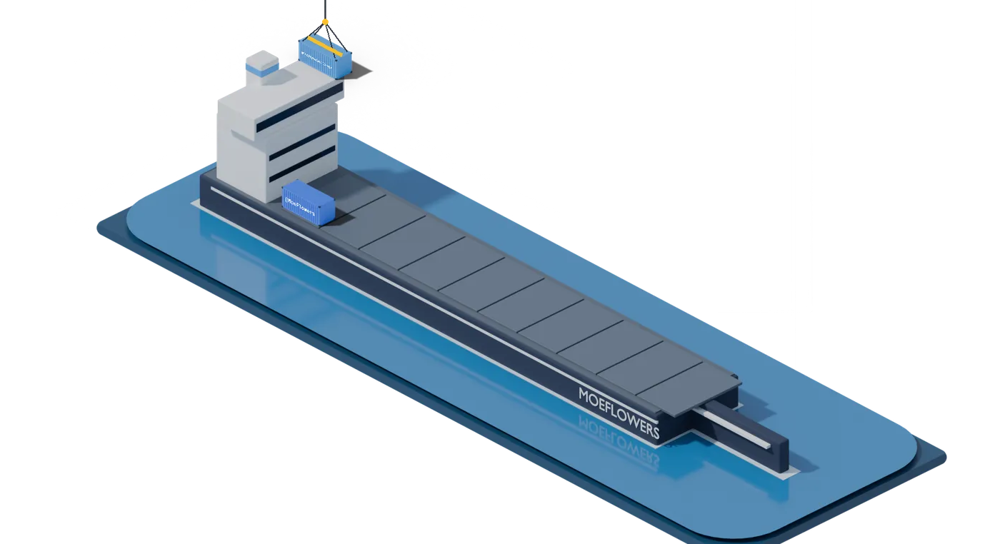

<h1 align="center">Moises Flores</h1>

  <b>Full-Stack Developer · Automation & AI</b> 
  Desarrollador Full-Stack · Automatización e IA

  <a href="https://portfolio-eosin-theta-40.vercel.app">Portfolio</a> ·
  <a href="https://www.linkedin.com/in/moeflowers-dev/">LinkedIn</a> ·
  <a href="mailto:moeflowers2@gmail.com">Email</a>

### Docker port · Puerto Docker

<!-- PUERTO:INICIO -->

  

  

<picture>
  <source media="(prefers-color-scheme: dark)" srcset="puerto/salida/a-bordo-oscuro-20261010230209.svg">
  
</picture>
<!-- PUERTO:FIN -->

### About me · Sobre mí

Full-stack developer with **3+ years** building web and mobile apps, bots and automations. I work in the **healthcare sector** (remote, international) and build **dual-currency billing and inventory systems** (USD/VES with the official BCV rate) for businesses in Venezuela and LATAM. I have automated about **21 h/week** of manual work across clients.

Desarrollador full-stack con más de 3 años creando apps web y móviles, bots y automatizaciones. Trabajo en el sector salud (remoto, internacional) y construyo sistemas de facturación e inventario en doble moneda para negocios de Venezuela y LATAM.

Yaracuy, Venezuela (UTC-4) · open to remote or hybrid work · Systems Engineer (UNEFA)

### Stack

### Projects · Proyectos

| Project | What it does · Qué hace | Stack |
|---|---|---|
| [**Puerto Vivo**](https://github.com/MoeFlowers/puerto-vivo) | Real-time 3D digital twin of a container terminal (simulated data) · Gemelo digital 3D de una terminal de contenedores | React Three Fiber · Blender |
| [**Ordo**](https://github.com/MoeFlowers/ordo) | Multi-currency personal finance PWA: debts, subscriptions, goals · Finanzas personales multimoneda | Vue · Supabase |
| **Point of Sale & Inventory** | Dual-currency (USD/VES · BCV) POS, inventory and billing for shops · Punto de venta e inventario en doble moneda | PHP · MySQL |
| [**Landings 3D**](https://github.com/MoeFlowers/landings-3d) | Three concept landing pages driven by Blender-rendered scroll sequences · Tres landings con secuencias renderizadas en Blender | Next.js · Blender |
| [**AI Book Recommender**](https://github.com/MoeFlowers/Sistema-de-Recomendaci-n-de-Libros-con-IA) | Collaborative filtering over 10k+ books, 85% user-validated accuracy · Recomendador de libros con IA | Python · Scikit-learn |

Full case studies · Casos de estudio: [portfolio](https://portfolio-eosin-theta-40.vercel.app)
