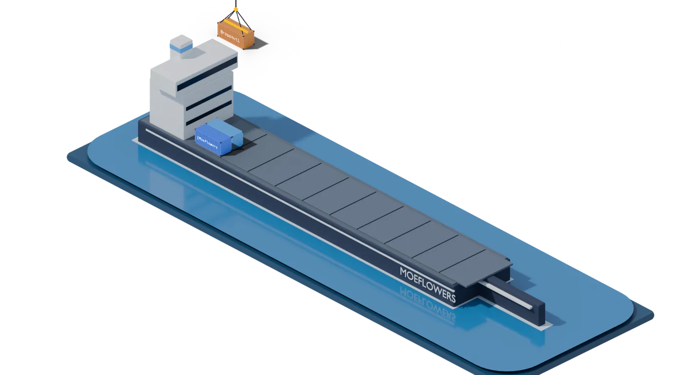

<h1 align="center">Moises Flores</h1>

  <b>Full-Stack Developer · Automation & AI</b> 
  Desarrollador Full-Stack · Automatización e IA

  &nbsp;
  &nbsp;
  &nbsp;
  

### Docker port · Puerto Docker

<!-- PUERTO:INICIO -->

  

  

<picture>
  <source media="(prefers-color-scheme: dark)" srcset="puerto/salida/a-bordo-oscuro-20261011002334.svg">
  
</picture>
<!-- PUERTO:FIN -->

### Sobre mí

<!-- INSPECT:INICIO -->

<!-- INSPECT:FIN -->

### Tecnologías

<!-- PS:INICIO -->

<!-- PS:FIN -->

### Proyectos

<!-- LIBROS:INICIO -->

<!-- LIBROS:FIN -->
